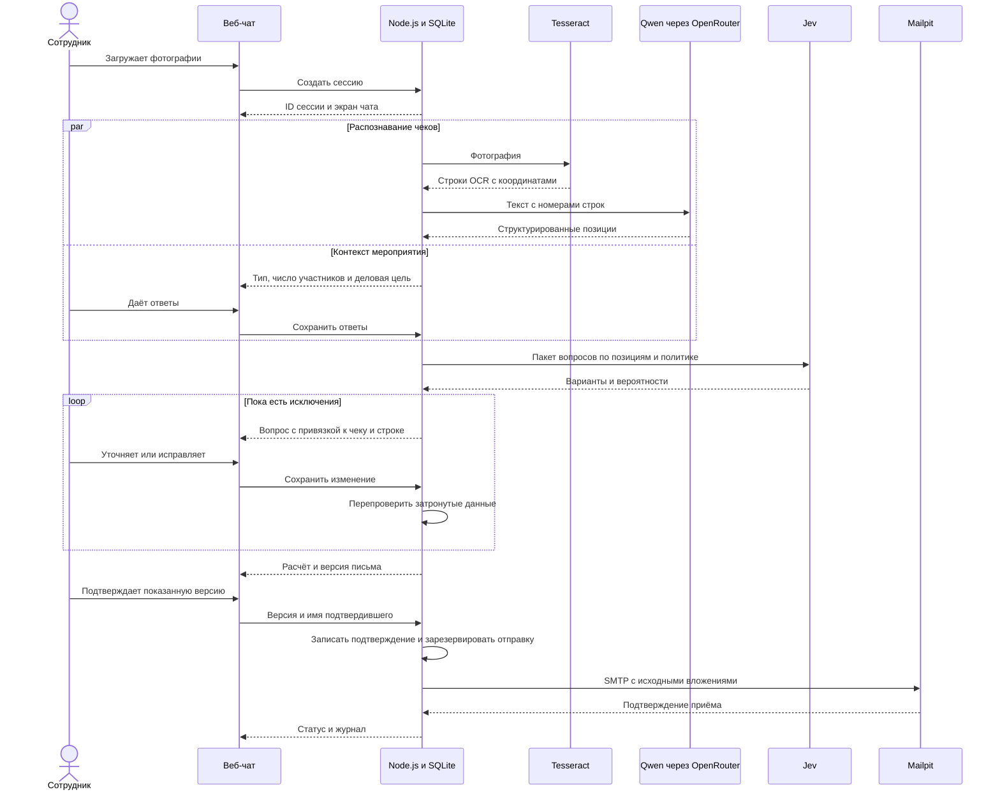

# Техническая спецификация Expense Reports Autopilot

Согласованная архитектура MVP. Пользовательский сценарий — в [SPEC.md](SPEC.md), правила возмещения — в [demo-policy.txt](demo-policy.txt).

## Компоненты и стек

| Компонент | Стек | Ответственность |
| --- | --- | --- |
| Веб-интерфейс | HTML, CSS и JavaScript, `fetch` и `EventSource` | Экран загрузки, чат со структурированными ответами и правками, карточка расчёта, подтверждение и служебная страница журнала по сессиям. |
| Сервер | Node.js 22, Express, Multer, Zod | Принимает загрузки, ведёт состояние, вызывает OCR и модели, формирует вопросы, проверяет расчёт и готовит письмо. Отдаёт страницы и API с одного origin. |
| Локальное распознавание | Tesseract CLI, английский языковой пакет, TSV | Распознаёт каждую фотографию. Возвращает текст, координаты и оценку распознавания слов для подсветки спорных строк. |
| Разбор текста | Qwen3.5-Flash через OpenRouter Chat Completions | Восстанавливает структуру чека из строк OCR и возвращает JSON с привязкой к источнику. |
| Семантическая проверка | Jev через TypeSafe `POST /v1/systemone` | Отвечает на именованные вопросы по позициям, сборам и деловой цели. Возвращает варианты ответов и вероятности. |
| Хранилище | `node:sqlite` и локальные bind mounts | Хранит состояние, ответы, снимок политики, проверки, версии письма, подтверждения и события. Исходные фотографии сохраняются отдельными файлами. |
| Почта | Nodemailer и Mailpit в Docker Compose | Сервер отправляет подтверждённое письмо по SMTP на `mailpit:1025` внутри сети Compose. Веб-ящик Mailpit на `127.0.0.1:8025` показывает письмо и вложения. |

Прототип запускается в Docker Compose. Tesseract входит в образ приложения. Для обращений к моделям нужны `OPENROUTER_API_KEY` и `TYPESAFE_API_KEY`. На хосте проверены Node.js 22, встроенный SQLite, Docker и Compose. Доступ к моделям и доставку SMTP проверяем при сборке. [Tesseract TSV](https://github.com/tesseract-ocr/tessdoc/blob/main/Command-Line-Usage.md#tsv-output), [Mailpit в Docker](https://mailpit.axllent.org/docs/install/docker/), [вложения Nodemailer](https://nodemailer.com/message/attachments.html)

## Запуск и локальные тома Docker Compose

`docker compose up --build` запускает два сервиса. Контейнер `app` включает Node.js 22 и Tesseract с языковым пакетом `eng`. Приложение слушает `0.0.0.0:3000` внутри контейнера. Контейнер `mailpit` принимает SMTP по адресу `mailpit:1025` во внутренней сети Compose. На хосте веб-приложение доступно на порту `3000`, а веб-ящик Mailpit — на `8025`. [Сеть Docker Compose](https://docs.docker.com/compose/how-tos/networking/)

| Монтирование | Режим | Содержимое |
| --- | --- | --- |
| `./data` → `/app/data` | Чтение и запись | Оригиналы и временные изображения хранятся в `receipts/<sessionId>/`. База `app.sqlite` в том же томе сохраняет состояние заявок и журнал при пересоздании контейнера. |
| `./demo-policy.txt` → `/app/policy/demo-policy.txt` | Только чтение | Текст политики хранится на хосте. При создании сессии сервер читает файл и записывает снимок политики в SQLite для последующей проверки и аудита. |

Оба тома используют локальные пути на хосте. Каталог данных должен быть доступен на запись процессу приложения, а файл политики должен существовать перед запуском. [Монтирования сервисов Compose](https://docs.docker.com/reference/compose-file/services/#volumes)

Пример `compose.yaml`:

```yaml
services:
  app:
    build: .
    depends_on:
      - mailpit
    ports:
      - "127.0.0.1:3000:3000"
    environment:
      - OPENROUTER_API_KEY
      - TYPESAFE_API_KEY
      - DATA_DIR=/app/data
      - POLICY_PATH=/app/policy/demo-policy.txt
      - SMTP_HOST=mailpit
      - SMTP_PORT=1025
    volumes:
      - type: bind
        source: ./data
        target: /app/data
      - type: bind
        source: ./demo-policy.txt
        target: /app/policy/demo-policy.txt
        read_only: true
        bind:
          create_host_path: false

  mailpit:
    image: axllent/mailpit
    ports:
      - "127.0.0.1:8025:8025"
```

## Порядок взаимодействия



## Контракты проверки и исправления

1. **Загрузка и OCR.** Сервер сохраняет неизменённые байты JPEG/PNG, оригинальное имя и `receiptId`. Хранит снимок текста политики с SHA-256. Для каждой фотографии запускает Tesseract с выводом TSV и группирует слова по строкам. Сохраняет стабильные `lineIds`, текст, координаты и оценки OCR.
2. **Qwen.** Один запрос на чек по умолчанию. JSON: продавец, дата, валюта, позиции, скидки, налоги, сборы, чаевые и итог. У каждого извлечённого поля есть исходные `lineIds`. Суммы передаются в целых центах или как `null` для нечитаемых значений. Qwen определяет структуру документа. Сервер валидирует JSON, проверяет существование исходных строк и сверяет итог с учётом скидок и сборов. Оригиналы остаются в локальном хранилище, в модель уходит нужный текст OCR без платёжных и контактных реквизитов.
3. **Jev.** Сервер формирует один пакет независимых именованных вопросов для состояния с позициями, релевантными строками, правилами политики и ответами пользователя. Идентификатор целевой позиции указывается в тексте вопроса. Результат привязан к имени модели, версии политики, позиции и вопросу.
4. **Уточнения.** Тип мероприятия выбирают из списка, число участников вводят как положительное целое, деловую цель — текстом. Сервер формирует вопросы по известным состояниям: нечитаемая цена, расхождение итога, неясная позиция, неизвестная доля сбора, слишком общая цель. Чат показывает исходную строку и фото, если вопрос относится к чеку. Исправление сохраняется с исходным и новым значениями. Сумма требует пересчёта и повторной сверки, изменившийся смысл позиции или распределение сбора — повторной проверки Jev.
5. **Расчёт.** Сервер допускает правила демо в USD, проверяет число участников и рассчитывает всё в целых центах. Сначала применяет решение по каждой строке. Затем суммирует разрешённые расходы по всем чекам и применяет лимит мероприятия: `min(разрешённые_расходы, лимит_на_участника × участники)`. При нулевой сумме сессия получает состояние `no_reimbursement`. При неразрешённом исключении состояние остаётся `waiting_for_input`.

### Вопросы Jev в MVP

| Вопрос | Тип | Применение |
| --- | --- | --- |
| К какой категории относится конкретная позиция? | `Choice`: еда, безалкогольный напиток, алкоголь, запрещённый напиток, вне делового питания, неясно | Привязать строку к правилу и показать основание. |
| Есть ли признаки, что спорный напиток алкогольный? | `Noul` | Уточнить сокращения и названия вроде `CIDER`. При неоднозначности или противоречии с категорией спросить пользователя. |
| К каким расходам относится общий сбор? | `Choice`: разрешённые, исключённые, смешанные, неясно | Для неясной доли разрешённых расходов запросить разбивку. Разбивка задаётся пользователем. |
| Покрывает ли выбранное правило неоднозначную позицию? | `Choice`: соответствует, не соответствует, недостаточно данных | Проверить спорную позицию с конкретным правилом, а для ясных категорий применить заданное в коде соответствие. |
| Содержит ли ответ конкретную деловую цель? | `Noul` | Запросить более конкретную формулировку при слабом сигнале. |

Сервер строит общий результат по политике из категорий, точечных ответов Jev, правил и арифметики. Для решения использует вероятность выбранного варианта `Choice` или вероятность «да» у `Noul`. Пороги — конфигурация прототипа, их значения проверяются на демо-чеках до прогона. Неоднозначность вызывает ручное уточнение. [Типы вопросов Jev](https://docs.typesafe.ai/introduction), [Что означает вероятность](https://docs.typesafe.ai/confidence)

Для Qwen — `qwen/qwen3.5-flash-02-23`, `response_format.type=json_schema` и `provider.require_parameters=true`. Сервер дополнительно валидирует ответ. Для Jev — алиас модели `jev-latest` из `GET /v1/models` с фиксацией возвращённого имени модели. Сбой провайдера отражается в чате, повтор запускает только упавший шаг. [Qwen на OpenRouter](https://openrouter.ai/qwen/qwen3.5-flash-02-23), [OpenRouter Structured Outputs](https://openrouter.ai/docs/guides/features/structured-outputs), [TypeSafe API](https://api.typesafe.ai/redoc)

## API, состояние и журнал

| Маршрут | Назначение |
| --- | --- |
| `POST /api/sessions` | Загружает фотографии и начинает обработку. Возвращает `sessionId`. |
| `GET /api/sessions/:id` | Возвращает снимок сессии для восстановления чата. |
| `GET /api/sessions/:id/events` | SSE, сохранённые и новые сообщения, вопросы, карточки, статусы и события журнала. |
| `POST /api/sessions/:id/messages` | Принимает структурированный ответ на вопрос или правку позиции. |
| `POST /api/sessions/:id/retry` | Повторяет шаг обработки после сбоя OCR или провайдера. |
| `POST /api/sessions/:id/approve` | Принимает `revision` и `approverName`. Проверяет сессию и текущую версию, записывает согласие и передаёт подтверждённый черновик на отправку. |
| `GET /api/audit/sessions` | Список сессий из SQLite с идентификатором, временем создания, типом мероприятия и текущим статусом. |
| `GET /api/audit/sessions/:id` | Сохранённый журнал выбранной сессии в хронологическом порядке. |

Основные состояния: `processing → waiting_for_input → checking_policy → waiting_for_approval → approved → sending → sent`. После ответа возможен повторный переход в проверку. Дополнительные состояния: `processing_failed`, `no_reimbursement`, `send_failed` и `delivery_unknown`. Сервер хранит сессии, чеки, версии и события в SQLite. Журнал связывает чек и OCR, ответы и правки, версии политики и моделей, результаты классификации и расчёта, подтверждение, вложения и исход SMTP.

### Служебная страница журнала

Маршрут `/audit` показывает список сессий и историю выбранной сессии. Страница читает сохранённые данные через API аудита. Для каждого события отображаются серверное время, действие, результат и связанный чек или позиция, когда они применимы. Для подтверждения отображается имя пользователя, для отправки — статус SMTP и `Message-ID`.

## Подтверждение и отправка

Сервер формирует неизменяемый черновик: получатель `accounting@example.test`, тема, текст, исходные вложения и расчёт. Только браузерное подтверждение текущей версии переводит черновик в `approved`. Подтверждение хранит имя пользователя и серверное время. После правки показывается новая версия, а подтверждение старой версии даёт `409`.

Серверная функция `sendExpenseEmail` перед SMTP атомарно переводит `approved` в `sending` и использует сохранённые данные. Повторный запрос получает существующий статус. Для версии сохраняется стабильный `Message-ID`. Успех фиксируется после положительного ответа SMTP. Если отправка могла завершиться до тайм-аута или перезапуска, состояние `delivery_unknown` требует сверки с Mailpit по `Message-ID` перед повтором. [Ошибки SMTP в Nodemailer](https://nodemailer.com/errors)

## Порядок сборки и проверки

| Время | Результат |
| --- | --- |
| 0–25 мин | Запустить Docker Compose и проверить монтирования, OCR на синтетическом чеке, доступ к обеим моделям и приём одного тестового письма в Mailpit. |
| 25–70 мин | Загрузка оригиналов, OCR и Qwen, SQLite, два экрана и поток событий. |
| 70–115 мин | Уточнения, пакет Jev, сверка и расчёт в центах, карточка заявки. |
| 115–155 мин | Версии письма, подтверждение, отправка с оригиналами, защита от повтора и служебная страница журнала. |
| 155–180 мин | Сквозной прогон из SPEC.md. Проверить закрытые исключения, применённый лимит, отсутствие письма до подтверждения, одно письмо после повторного клика и совпадение вложений с исходными файлами. |

Пример стоимости моделей для заявки с одним чеком: 1 500 входных и 400 выходных токенов Qwen плюс 2 000 входных токенов Jev дают около **0,29 USD за 1 000 заявок** по опубликованным тарифам. Это расчётный пример. Фактические затраты, время ожидания и долю ручных правок измеряем на одинаковых чеках. [Тариф Qwen](https://openrouter.ai/qwen/qwen3.5-flash-02-23), [тариф Jev](https://help.typesafe.ai/articles/5187202169-how-much-does-jev-cost)
